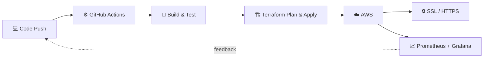

<!-- ═══════════════ HEADER ═══════════════ -->


<div align="center">

<a href="https://github.com/AryanSharma2206">
  
</a>

<br/>


</div>

---

## 👨‍💻 About Me

```bash
$ whoami
aryan-sharma

$ cat profile.txt
role       : DevOps & Cloud Intern @ Dotesquars
education  : B.Tech CSE (AI & DS) @ Poornima University
location   : Jaipur, India 🇮🇳
focus      : Infrastructure as Code | CI/CD | Monitoring | Cloud Automation
mindset    : "If you do it twice, automate it."
```

I like closing the gap between **dev** and **ops**: taking a project from `git push` to a secure, monitored, live deployment with as little manual work as possible.

---

## 🧰 Tech Arsenal

<div align="center">

**☁️ Cloud & Infrastructure**


**🔄 CI/CD, Monitoring & Tooling**


**💻 Languages & Web**


<br/>


</div>

---

## 🔄 How I Ship



---

## 🚀 Featured DevOps Projects

<table>
  <tr>
    <td width="50%" valign="top">
      <h3>🌐 <a href="https://github.com/AryanSharma2206/website-CI-CD-terraform">Website CI/CD with Terraform</a></h3>
      <p>Version 2 of a dynamic website deployment, with the infrastructure fully defined as code.</p>
      
      
      
    </td>
    <td width="50%" valign="top">
      <h3>⚙️ <a href="https://github.com/AryanSharma2206/Git-Action-website-project">GitHub Actions Website Deploy</a></h3>
      <p>Website deployment automated end to end with GitHub Actions workflows and AWS connectivity.</p>
      
      
    </td>
  </tr>
  <tr>
    <td width="50%" valign="top">
      <h3>💡 <a href="https://github.com/AryanSharma2206/LAMP-Project-Setup">LAMP Stack Auto-Setup</a></h3>
      <p>Every installation a new project needs is automated and provisioned with Terraform.</p>
      
      
      
    </td>
    <td width="50%" valign="top">
      <h3>🔒 <a href="https://github.com/AryanSharma2206/SSL-Certificate-Setup">SSL Certificate Setup</a></h3>
      <p>Moving a website from HTTP to secure HTTPS with SSL certificates.</p>
      
      
    </td>
  </tr>
  <tr>
    <td width="50%" valign="top">
      <h3>📈 <a href="https://github.com/AryanSharma2206/Prometheus-Grafana-System--Monitoring">Prometheus + Grafana Monitoring</a></h3>
      <p>System monitoring with metrics collection and dashboards.</p>
      
      
    </td>
    <td width="50%" valign="top">
      <h3>☸️ <a href="https://github.com/AryanSharma2206/AWS-EKS-Hosted-website">Website on AWS EKS</a></h3>
      <p>A website hosted on Kubernetes using Amazon EKS.</p>
      
      
    </td>
  </tr>
  <tr>
    <td width="50%" valign="top">
      <h3>🛡️ <a href="https://github.com/AryanSharma2206/Cloud-custodian-project">Cloud Custodian</a></h3>
      <p>Cloud governance and resource policy automation with Cloud Custodian.</p>
      
      
    </td>
    <td width="50%" valign="top">
      <h3>🤖 <a href="https://github.com/AryanSharma2206/Ansible-worker-controller">Ansible Controller & Workers</a></h3>
      <p>Configuration management across a controller node and worker nodes using Ansible.</p>
      
      
    </td>
  </tr>
</table>

<details>
<summary><b>🐧 Linux tooling & more (click to expand)</b></summary>
<br/>

- 📚 [linux-cheat-sheet](https://github.com/AryanSharma2206/linux-cheat-sheet): a Linux command reference (⭐ my most-starred repo)
- 🧾 [linux-cheatsheet-generator](https://github.com/AryanSharma2206/linux-cheatsheet-generator): a CLI cheat-sheet generator with GitHub automation
- 🗺️ [AWS-Articture-Digram-Hands-on](https://github.com/AryanSharma2206/AWS-Articture-Digram-Hands-on): AWS architecture diagrams as blueprints of a flow
- 📧 [Mass-Emailing-System](https://github.com/AryanSharma2206/Mass-Emailing-System)

</details>

<details>
<summary><b>📊 Beyond DevOps: Data & AI/ML (click to expand)</b></summary>
<br/>

- 🏏 [Social Media Performance Dashboard](https://github.com/AryanSharma2206/Social_media_performance_dashboard_NewZealand-): Power BI + Snowflake dashboard built with **New Zealand Cricket** in a 5-person virtual internship team
- 💻 [laptop_price_prediction](https://github.com/AryanSharma2206/laptop_price_prediction): regression model in a Jupyter notebook
- 🧬 [tumor_classification](https://github.com/AryanSharma2206/tumor_classification)
- 📈 [binary-logistic-regression-from-scratch](https://github.com/AryanSharma2206/binary-logistic-regression-from-scratch)
- 🧠 [AI-ML-Internship](https://github.com/AryanSharma2206/AI-ML-Internship)

</details>

---

## 📊 GitHub Stats

<div align="center">


</div>

### 🏆 Trophies

<div align="center">
  
</div>

### 🐍 Contribution Snake

<div align="center">
  
</div>

---

## 🎯 Currently

- 🔭 Building and automating cloud infrastructure at **Dotesquars**
- 🌱 Going deeper into **Kubernetes, Terraform modules and observability**
- 📝 Turning my hands-on labs into reusable, documented projects
- 🤝 Open to collaborating on **DevOps, cloud automation and CI/CD** projects

---

## 📫 Let's Connect

<div align="center">

<a href="https://www.linkedin.com/in/aryan-sharma-a2a240353/"></a>
<a href="mailto:aryansharma2206@gmail.com"></a>
<a href="https://github.com/AryanSharma2206?tab=repositories"></a>

<br/><br/>

> *"Code. Deploy. Scale. Repeat."*
> Automating the future, one pipeline at a time.

</div>


